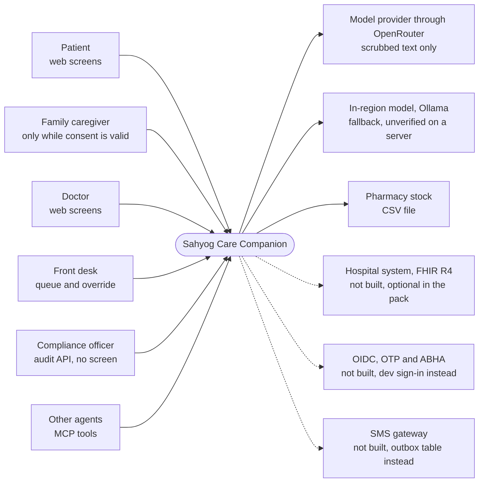
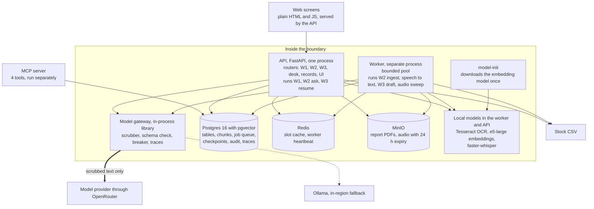
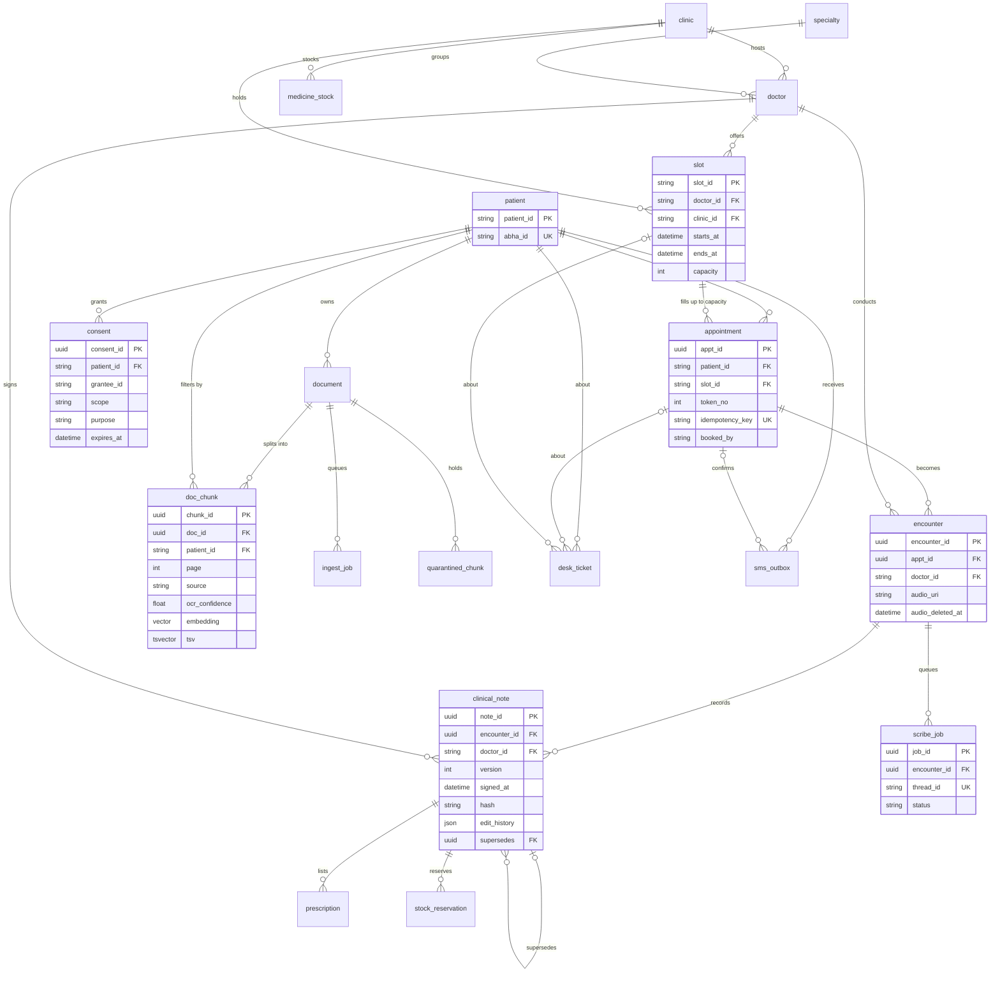
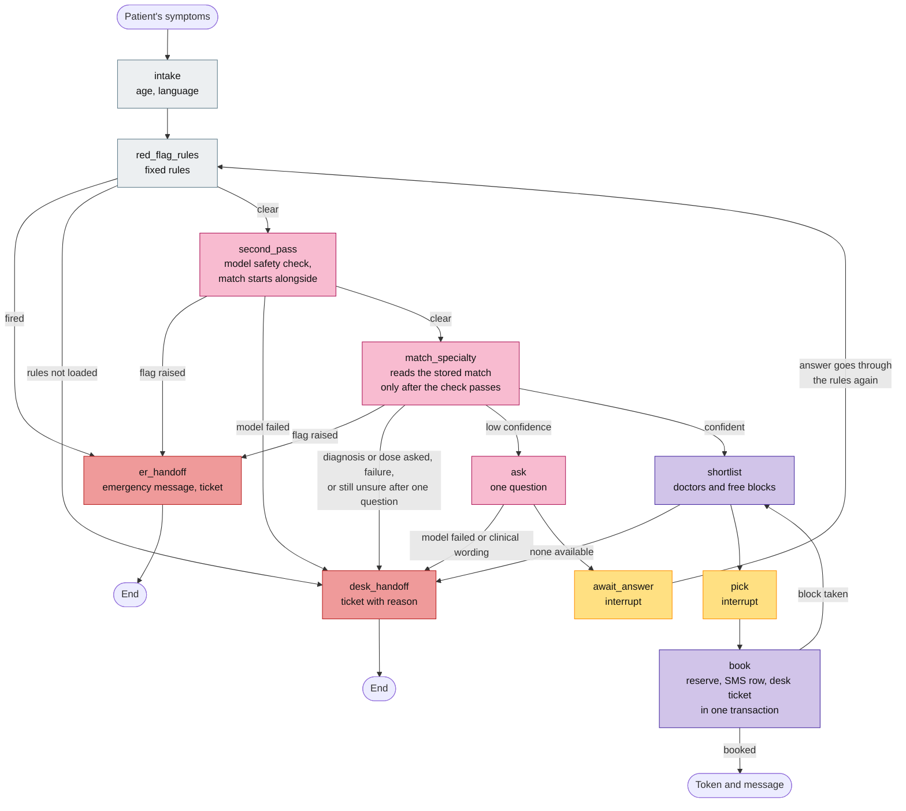
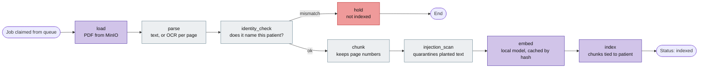
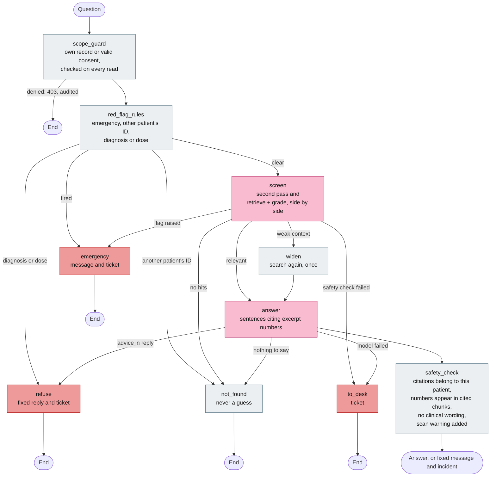
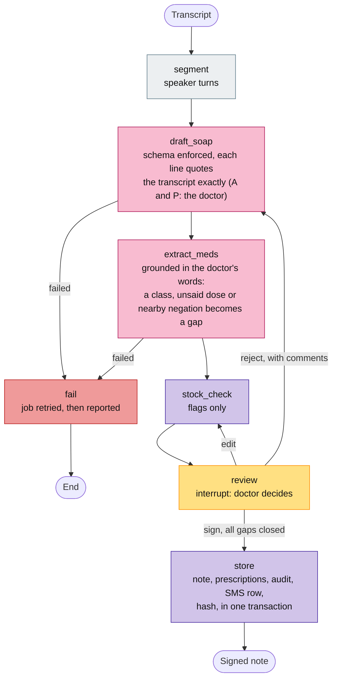
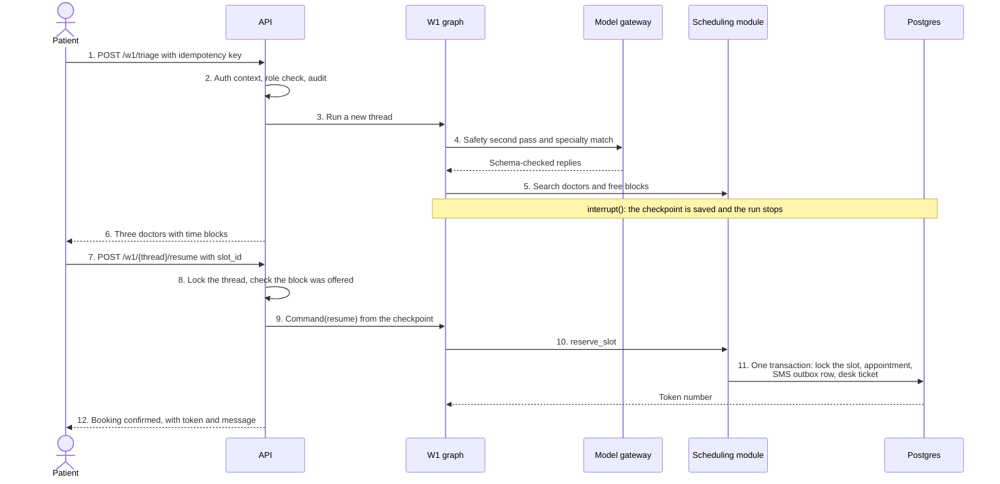
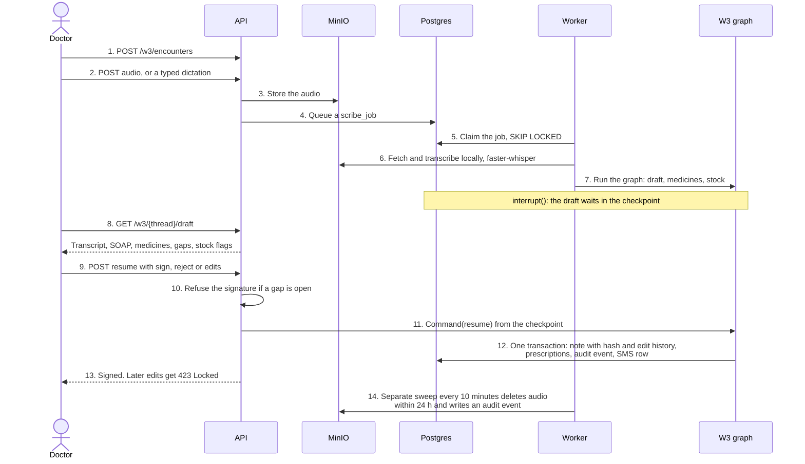

# Sahyog Care Companion · Architecture pack

> **Written for the MVP.** This pack describes the MVP's code at `s7-accepted`. This final build has the same architecture, plus the fixes its reviews made (listed in `AI-COLLABORATION.md`): for example, a stricter grounding of medicines and doses in W3, a stricter wrong-patient check in W2 ingest, fenced ingest workers, a desk-move lock, and wider red-flag and wording rules. Where a detail below differs, the code and the log are right. **Numbers in sections 6 and 7 (recall, scan-read error rate, triage speed) are the MVP's and weren't re-run in this build.** The PDF is the same text.

| | |
|---|---|
| **Version** | 1.0, 2026-11-02 |
| **Describes** | The MVP's code at its tag `s7-accepted`. This repo's `main` adds the review fixes (see the note above). The tag exists only in the MVP repo |
| **Required by** | Engagement pack p48: context, container, entity model, three graphs and two sequences, all corrected from the pack |
| **Timing** | Written after the build. The engagement pack asks for version one on day 5, before graph code, so this doesn't meet that ordering |

## How to read this

- **Every diagram shows what the code does today**, including where that differs from the engagement pack's design. [Section 6](#6-corrections-from-the-engagement-pack) lists each difference and why it exists.
- **Dashed or labelled "not built" means it doesn't exist.** This is a demo on synthetic data, running on one Mac. [ADR 0005](adr/0005-hybrid-deployment.md) proposes how it would be deployed, and nothing there is deployed.
- **The design has one argument:** anything that can harm a patient is decided by code or by a named person, and the model only handles the fuzzy steps. A prompt can be argued with, but a SQL filter can't.

**Colours in the graphs**

| Colour | Meaning |
|---|---|
| Grey | Plain code |
| Pink | Calls a model |
| Purple | Uses a tool or data service |
| Gold | Pauses for a person |
| Red | Ends in a hand-off to a person |

---

## 1. Context view

Who uses the system and what it depends on.

**What each person is owed**

| Person | Fear | What the system shows them |
|---|---|---|
| Chief medical officer | AI advice harms a patient | Red-flag gate before any match, and refusal of diagnosis and dose questions (by the model's flag, with word checks as a backstop: they caught 6/25 unseen advice questions in this build, 0/7 in Hindi) |
| Patient | A stranger reads their reports | Patient filter in SQL, and citations on every answer |
| Doctor | Blamed for an AI note | Nothing is stored until they sign, and a named medicine is never invented |
| Front desk | Being replaced | Hand-offs come to their queue, and they can override any assistant booking |
| Compliance officer | A data-protection breach | Consent rows, and an audit event for each record read |
| Pharmacy | Software substituting medicines | Stock flags only, with the choice left to the doctor |

---

## 2. Container view

Everything inside the dashed box runs on one machine under Docker Compose. Only scrubbed text leaves it.

**Key choices**

| Choice | Why | What it costs |
|---|---|---|
| One API plus one worker, instead of five services | A two-week build, and modules keep the seams (`sahyog/scheduling`, `records`, `scribe`, `safety`) | They can't yet scale or deploy apart |
| Separate worker | OCR and embedding can't starve triage | One more process to watch, so `/health` reports its heartbeat |
| Postgres as the queue | `FOR UPDATE SKIP LOCKED` keeps the job and its document in one transaction | Held in the Mac test, but unproven on real infrastructure |
| Graph runs resume from checkpoints | Any API replica could resume any thread | Tested with one process only |
| One way out for clinical text | Every model call goes through the gateway, which scrubs first | It's a code-level rule. ADR 0005 adds a network allowlist, which isn't built |

**Guardrails on every model call** ([`sahyog/llm/gateway.py`](../sahyog/llm/gateway.py))

- Scrubs identifiers before text leaves, and restores placeholders only for the caller.
- Rejects any reply that doesn't match the schema.
- Applies a timeout, and tries the primary route twice before the fallback.
- A circuit breaker gives a provider no calls for 30 seconds after 5 failures in a row. It's per process.
- Writes one `trace_span` row with tokens, cost and latency, and no prompt text.
- When the model fails, the run goes to the human desk.

---

## 3. Entity model

There are 23 application tables, from [`sahyog/models.py`](../sahyog/models.py). LangGraph's checkpoint tables sit beside them. Only key columns are shown.

**Tables with no foreign keys, by design**

| Table | Purpose |
|---|---|
| `audit_event` | One row per record read or denied action. It names the record by ID so it can outlive the record |
| `trace_span` | One row per model call |
| `idempotency_record` | Stored replies, so a retried request gets the first answer |
| `embedding_cache` | Embeddings by content hash |

**Rules the schema carries**

- **A slot is a block of time with a capacity, not one appointment.** Patients get a token number and a time block, never an exact minute. A unique constraint on slot and token prevents two patients getting one token, and a database trigger rejects a token above the block's capacity.
- **The audit log is append-only, and a signed note can't change.** Both are enforced by database triggers, so the rule holds even for code that bypasses the API.
- **`doc_chunk` repeats `patient_id`** so the search filter doesn't depend on a join.
- **`prescription.medicine_id` isn't a foreign key,** so a doctor can prescribe something off the stock list, stored as `UNLISTED`.
- **`consent.grantee_id` isn't a foreign key,** because there's no caregiver table yet.

**Gap:** `docs/data-contracts/` has no contract for `scribe_job`, `stock_reservation` or `trace_span`.

---

## 4. The three workflow graphs

W2 is two compiled graphs, so there are four in all. Each has its code in `sahyog/graphs/`.

### W1 · Find my doctor ([`w1.py`](../sahyog/graphs/w1.py))

Keeps state in the Postgres checkpointer and pauses twice for the patient.

**Why it's built this way**

- **The safety check always comes first.** The match runs alongside it only to meet the 4 second target, and its result isn't read until the check passes.
- **A clarifying answer goes back through the rules,** because the answer itself may describe an emergency.
- **A gate with no rules fails closed.** If the rule list didn't load, the patient goes to the desk.
- **The patient can only pick a block they were offered.** The API checks this before resuming.

### W2 · My records, ingest ([`w2_ingest.py`](../sahyog/graphs/w2_ingest.py))

Runs on the worker. The `ingest_job` table holds its progress, so it has no checkpointer.

No model outside the boundary is called here. OCR and embeddings are both local.

### W2 · My records, ask ([`w2_ask.py`](../sahyog/graphs/w2_ask.py))

Runs on the request and streams only after the safety check, so a blocked answer is never partly shown.

**Why a patient can't see another patient's data:** the filter is in the SQL ([`records/search.py`](../sahyog/records/search.py)), and its `patient_id` is checked against the login (`can_read` in the scope guard) before any search, never taken from the model. A poisoned PDF can change what the model says, but it can't widen a `WHERE` clause. The red-team set tests this end to end.

### W3 · Consultation scribe ([`w3.py`](../sahyog/graphs/w3.py))

The worker runs it up to the doctor's review. The API resumes it from the checkpoint when the doctor decides.

**Why it's built this way**

- **`store` is the only node that writes a clinical act,** and it can only run after a signature.
- **The API refuses to sign while a gap is open.** The model can't fill a molecule the doctor didn't say. If the doctor said "a statin", the doctor has to name it.
- **Grounding trusts the transcript.** It can't catch a speech-to-text error, such as "Known diabetic" heard as "NON diabetic". The review screen shows the transcript and a warning, but nothing forces the doctor to read it.

---

## 5. The two sequences

### Booking a slot through W1

The API holds no conversation in memory. Between messages 6 and 7, the run exists only as a checkpoint in Postgres.

A retry with the same key returns the first booking. A retry can't send a second SMS, because the SMS row is written only for a new booking.

### A consultation becomes a signed note

The bucket's expiry rule is the backstop for step 14. The sweep exists so that "who deleted it, and when" has an answer.

---

## 6. Corrections from the engagement pack

Each row is a place where this build departs from the pack's design.

| Area | The pack says | What's built | Why, and what it means |
|---|---|---|---|
| **Gateway** | API gateway with OIDC, rate limits, routing and audit headers | None. FastAPI is reached directly | **Rate limiting isn't built,** so the pack's slot-hoarding test (1,000 bookings get twenty) would fail as written. A patient can hold only one place per block |
| **Identity** | OIDC with OTP, and ABHA as an extension | Local signed tokens and a dev sign-in | Must stay off in any shared environment |
| **Services** | Agent, scheduling, records, scribe, audit and consent services | One API and one worker, with modules | Faster to build, and the module seams remain |
| **LLM route** | LLM API | OpenRouter, a further third party | The user's choice ([ADR 0004](adr/0004-provider-and-traces.md)). India-only processing isn't provided on this route, and some other people's names can leak |
| **Hospital system** | FHIR R4 reader | Not built | Optional in the pack. Demographics come from seeded tables |
| **Stock** | One interface with CSV and API adapters | The interface and the CSV adapter | The API adapter waits on the client's API |
| **Slots** | Free-or-taken slots, with capacity as the fallback | Blocks with capacity and tokens | Nobody can predict consultation length, so exact minutes aren't promised |
| **W1** | Rules, match, shortlist, options, pick, book | Adds a model second pass, and hand-offs from every step | Rules alone caught about half of unseen phrasing. The second pass narrowed that gap on the MVP's probes, one of which wasn't blind. The independent check hasn't run |
| **W2 ingest** | Tags PHI with Presidio while ingesting | Adds an identity check and injection scan, and scrubs at the gateway instead | Chunks stay as printed, inside the boundary, and scrubbing happens only when text leaves |
| **W2 ingest** | Parallel ingest with the Send API | A bounded worker pool on the queue, no Send API | **Misses an Architect-tier item** |
| **W2 ask** | Scope, retrieve, grade, answer, safety | Adds a red-flag check, number check and scan warning | A patient may mention an emergency while asking about a report, and about 1 in 200 scan-read numbers is wrong (MVP measurement) |
| **W3** | STT is a separate service, and a timeout parks the draft | STT runs in the worker, and the draft simply waits with no timeout | Simpler, with no audio leaving the boundary. A forgotten draft stays open |
| **Booking sequence** | Sends SMS through a gateway | Writes an outbox row in the booking transaction | No real gateway exists, so no SMS is actually delivered |
| **Memory** | Long-term store keyed by patient | Not built | Language comes from each request, and nothing is remembered between threads |
| **Thread expiry** | Checkpoints purged after 30 days | A manual command, `make purge-threads` | Nothing runs it on a schedule, so thread state stays until someone does |
| **Tools** | Timeouts and backoff on every tool | Timeouts and the breaker on model calls, and retries on database nodes | Other tools have no timeout of their own |
| **Traces** | Langfuse, with spans per node | A Postgres table, model calls only | Langfuse was too heavy for the machine ([ADR 0004](adr/0004-provider-and-traces.md)) |
| **Judge** | Calibrated, using ragas | Uncalibrated, using the published method through the gateway | Ragas would bypass the scrubber. Calibration needs 15 more human grades |

---

## 7. What this architecture hasn't proved

- **Scale:** it has run on one Mac with one API process. Triage narrowly missed its 4 second p95 at the target rate, at 4.28 s (MVP load test, not re-run).
- **Emergencies:** the independent test of emergency phrasing has never run. This is the top risk in [the final report](FINAL-REPORT.md).
- **Clinical safety:** no clinician has reviewed the rules, prompts or messages.
- **Real documents:** scans and audio have all been synthetic.
- **Recovery:** no backups exist, and restore is untested.
- **MCP:** its tools were called directly and listed, but not from a real MCP client.

## Related documents

- Decisions: [ADRs 0001–0005](adr/)
- Data rules: [data contracts](data-contracts/README.md) and [red-flag rules](safety/red-flag-rules.md)
- Results: [final report](FINAL-REPORT.md)
- Walkthrough: [demo script](demo-script.md)
